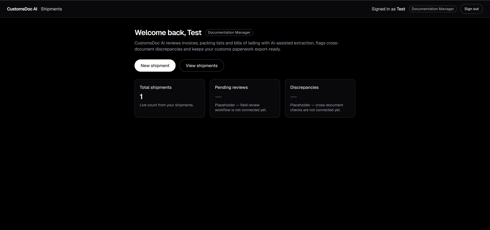
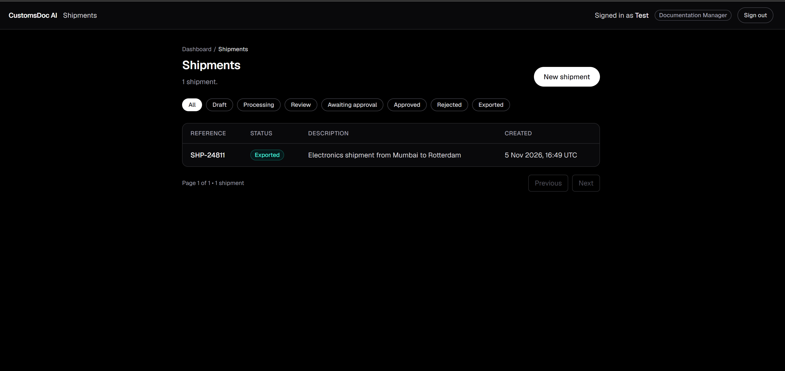
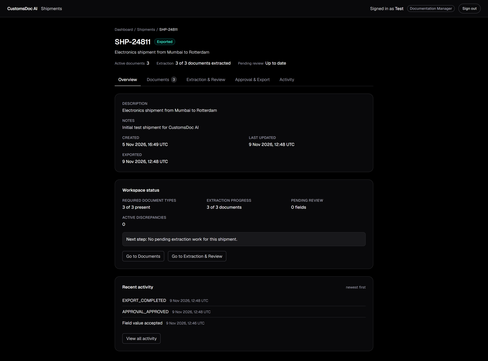
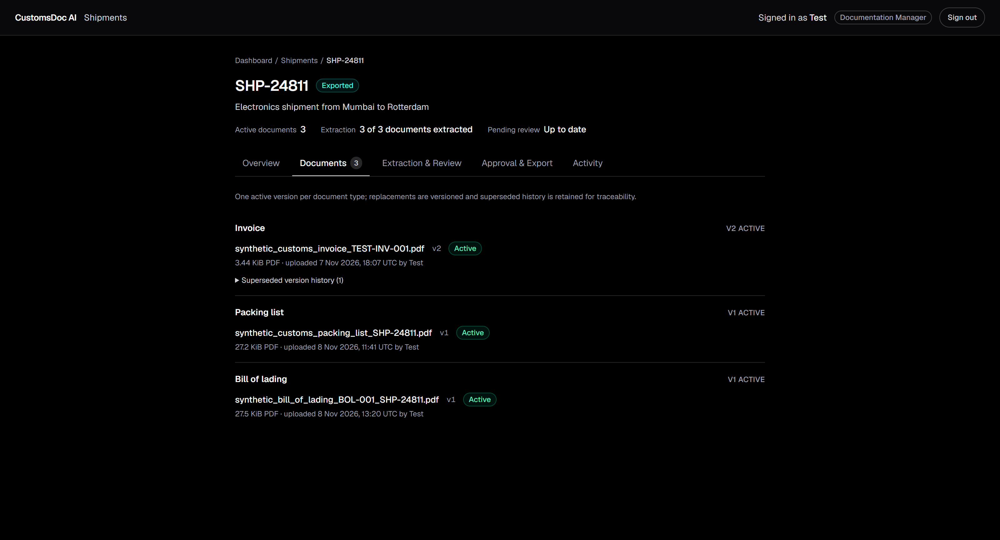
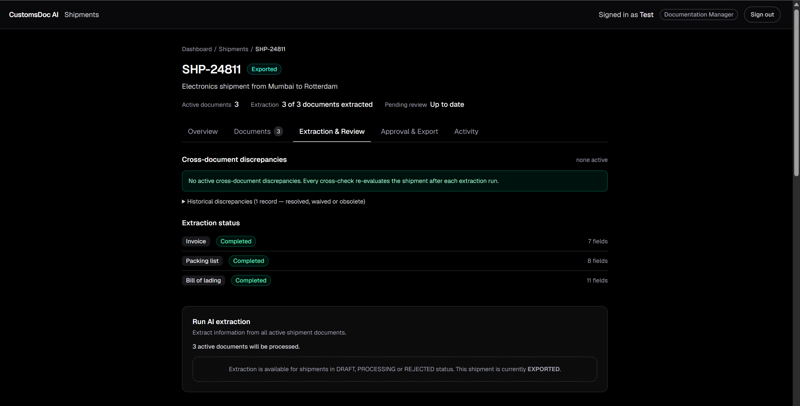
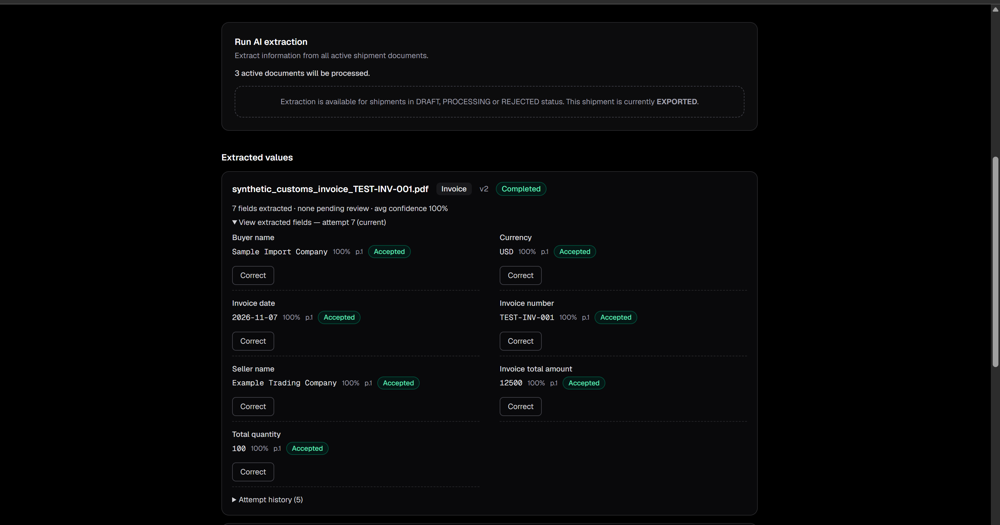
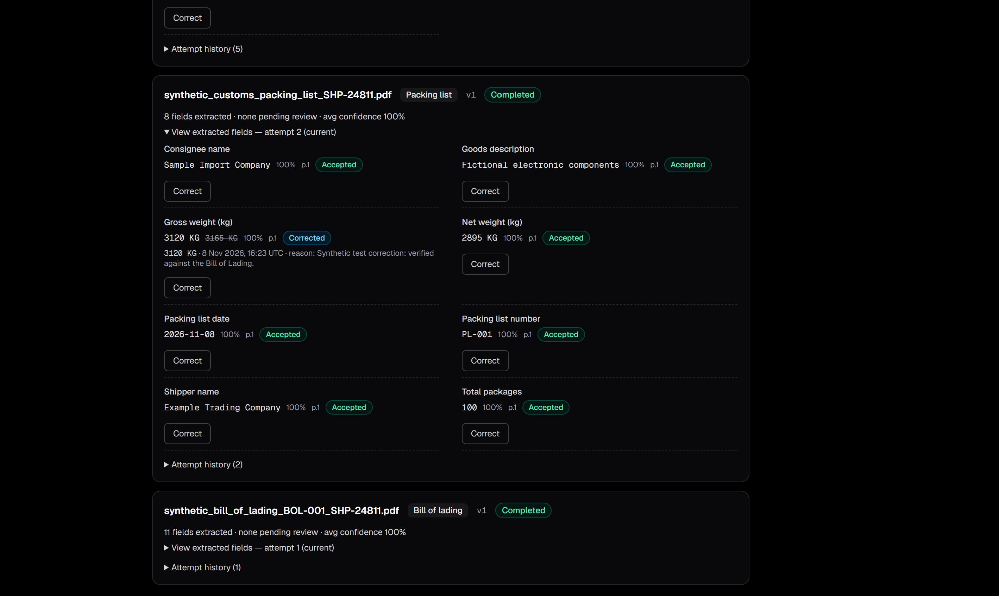
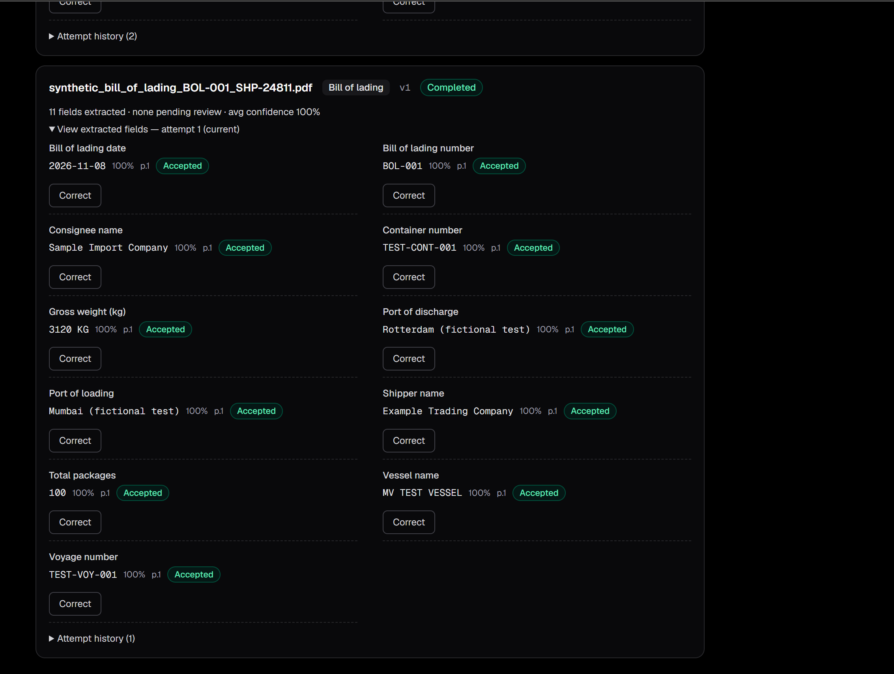
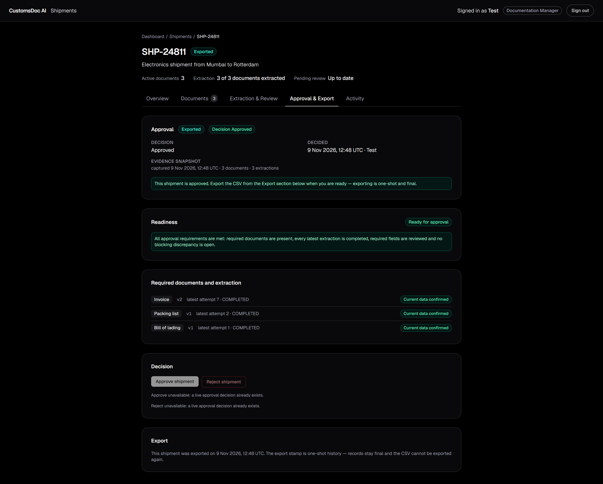
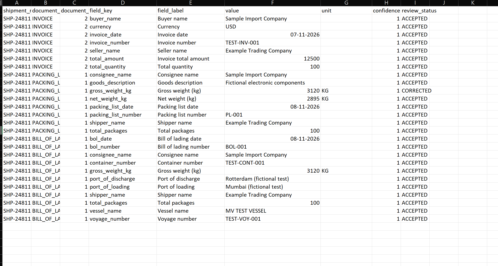

# CustomsDoc AI

AI-assisted customs document verification with human-in-the-loop review, cross-document discrepancy detection, manager approval and audited CSV export.

**Repository:** <https://github.com/jaikishan1234/customsdoc-ai>

> **Status:** local development application (runs on `localhost`). It has **not** been deployed to Vercel yet, and no public demo credentials are configured yet. See [`deployment.md`](./deployment.md) for local setup and not-yet-executed deployment steps.

---

## 1. Overview

CustomsDoc AI is a web application that takes a shipment folder of three customs documents — a commercial **Invoice**, a **Packing List** and a **Bill of Lading** (PDF) — and turns them into verified, decision-ready data:

1. Documents are uploaded to private storage and checksummed (SHA-256).
2. An AI model (Google Gemini, structured output) extracts catalogued fields from each document.
3. Every extraction is validated server-side against a field catalog before anything is stored.
4. Humans review field values (accept or correct), the system cross-checks documents against each other (e.g. gross weight on the packing list vs. the bill of lading), and live discrepancies are surfaced.
5. A manager approves the shipment only when every readiness rule passes; the approval freezes a tamper-evidence snapshot.
6. Any evidence change after approval automatically invalidates the approval.
7. A manager can then export a deterministic, RFC-4180 CSV — a one-shot, audited action that stamps the shipment **EXPORTED**.

The result is a defensible audit trail: who extracted what (with which attempt), who accepted or corrected each value, which discrepancy evidence changed when, who approved, and who exported — all append-only.

---

## 2. Problem Statement and Motivation

Manual customs document checking is repetitive and error-prone:

- The same data points (numbers, dates, weights, parties, currencies) are re-read from three documents per shipment.
- A single digit difference between a packing list and a bill of lading — e.g. a gross weight of 3,165 kg vs 3,120 kg — can cause customs holds, penalties and demurrage.
- Paper trail is weak: even diligent brokers rarely record *who* typed *which* value into the declaration, *when*, and on the basis of *which* document version.

CustomsDoc AI motivation:

- **Let the AI do the typing, not the deciding.** Extraction is automated and validated, but every value is confirmed (accepted or corrected) by a human before it counts.
- **Make discrepancies impossible to miss.** Cross-document comparisons run automatically on confirmed values and converge into live discrepancy rows that block downstream progress.
- **Make the trail provable.** Immutable document versions, immutable extraction attempts, append-only corrections, append-only audit log, and an approval snapshot that is re-verified against current evidence — drift invalidates the approval.
- **One-shot export.** The final CSV is produced once, stamped, and audited; exported evidence can never be silently edited afterwards.

> **Data policy.** The Gemini adapter is designed so real customs documents must never be sent through it: the workflow used for development and verification relies on synthetic documents. The adapter keeps no Google-side interaction retention (`store: false`) and deletes uploaded files immediately after generation.

---

## 3. Core Features

All features below are implemented in the source code on the current `master` branch.

- **Authentication and roles** — Better Auth email + password auth with a server-owned `role` field (see §4).
- **Shipment lifecycle** — create shipments with a validated `SHP-####` reference (`SHP-[0-9]{4,10}`); the status machine is `DRAFT → PROCESSING → (REVIEW ⇄ REJECTED) → APPROVED → EXPORTED`, with every transition owned by a service layer.
- **Document management** — immutable per-version document rows in private Cloudinary storage (raw, authenticated PDFs, ≤ 25 MiB, magic-byte-verified); re-upload supersedes the active version, never mutates or deletes history; duplicate checksums rejected; uploads to EXPORTED shipments blocked.
- **AI extraction** — per-document extraction attempts with full history (`PENDING / PROCESSING / COMPLETED / FAILED / SUPERSEDED`); strict schema-based validation; the freshness rule *current attempt = max(attempt) across ALL statuses* is enforced by every downstream reader.
- **Human review** — accept or correct (with a mandatory reason) for each extracted field; acceptance is manager-only; corrections are append-only with value snapshots; the effective value for a corrected field is always the latest correction.
- **Cross-document discrepancy detection** — one cross-check run converges live discrepancy rows onto the current evidence (`OPEN`, `RECHECK_PENDING`, `OBSOLETE`); `RESOLVED`/`WAIVED` are human-decided states that are never touched automatically; every in-place evidence change is audited *before* the write.
- **Approval with tamper evidence** — manager approval is possible only when all readiness rules pass; the decision stores a snapshot (document ids, types, versions, checksums and the paired extraction ids); the snapshot is re-verified against current evidence and any drift automatically invalidates the approval (mapped to a protected-by-invalidation status).
- **CSV export** — manager-only, deterministic RFC-4180 output with a one-shot `APPROVED → EXPORTED` guarded stamp and an `EXPORT_COMPLETED` audit event.
- **Append-only audit trail** — every mutation category is audited with actor (or a null system actor), entity, shipment context and JSON details; a structural gauntlet of CHECK constraints backs the service-layer rules.
- **Audit-gap self-report** — an opt-in, read-only diagnostics endpoint makes failed audit writes findable after the fact (see [`deployment.md`](./deployment.md) §8–§9, and the troubleshooting section for the recovery path).

---

## 4. Roles and Permissions

Two roles are defined in `src/lib/auth.ts`. The `user.role` column is written **server-side only** (`input: false` in the Better Auth config): sign-up always creates a **DOCUMENTATION_EXECUTIVE** and no API or UI can change a role. Promoting a user to manager is a deliberate database operation (see [`deployment.md`](./deployment.md), "Demo accounts").

| Capability | DOCUMENTATION_EXECUTIVE | DOCUMENTATION_MANAGER |
| --- | --- | --- |
| Sign in / browse shipments | ✅ | ✅ |
| Create shipments | ✅ | ✅ |
| Upload / replace documents | ✅ | ✅ |
| Run AI extraction | ✅ | ✅ |
| Run Gemini / audit-gap diagnostics | ✅ | ✅ |
| Produce documents (read everything) | ✅ readers | ✅ readers |
| Accept extracted fields | ❌ (manager-only decision) | ✅ |
| Correct extracted fields (with reason) | ❌ | ✅ |
| Approve / reject shipments | ❌ | ✅ |
| Export CSV | ❌ | ✅ |

Role checks are performed twice by design: the UI hides controls it cannot authorize, and every API route re-verifies the role server-side from the session (`src/lib/server/auth.ts`). Hiding controls is a convenience, never the authorization boundary.

---

## 5. End-to-End Workflow

1. **Create shipment** — a signed-in user creates a shipment with a unique `SHP-xxxxxx` reference, optional description and notes. Status: `DRAFT`.
2. **Upload documents** — upload the three required PDFs (Invoice, Packing List, Bill of Lading). Each upload: validates PDF magic bytes and the 25 MiB cap → streams to private Cloudinary storage → SHA-256 checksum → immutable version row (`documents`). Re-uploads create a new version and supersede the old one. Shipment moves to `PROCESSING` during the workflow.
3. **Run extraction** — one button per shipment run: for each active document (sequentially), the service reserves a daily rate-limit slot, reads the stored bytes, **re-verifies the SHA-256 against the database**, uploads the PDF to the Gemini Files API, generates structured output against the catalog-derived JSON schema, validates the response strictly, and persists an attempt + field rows. Status flips to COMPLETED/FAILED; freed daily slots and stale `PROCESSING` rows have defined recovery paths.
4. **Review fields** — the Extraction & Review tab shows every field of the *current completed* attempt with its confidence and review state:
   - **Accept** (manager): the original extraction value is confirmed correct.
   - **Correct** (manager): a new value + mandatory reason; an append-only `field_corrections` row is written; the effective value becomes the corrected one; the cross-check re-runs.
   - Required fields and low-confidence values demand review before the shipment can progress.
5. **Discrepancy handling** — the cross-check compares confirmed values across documents (currently: `gross_weight_kg`, packing list vs bill of lading, no tolerance band, CRITICAL severity). Mismatches become **OPEN** rows with expected/actual/delta evidence; corrections that equalize values converge rows to **OBSOLETE**; unverifiable evidence keeps rows alive as **RECHECK_PENDING** rather than assuming the mismatch disappeared.
6. **Approval** (manager) — the Readiness panel evaluates, live from the database: all three document types active; every active document's latest attempt COMPLETED; all catalog-required fields ACCEPTED or CORRECTED; no OPEN/RECHECK_PENDING discrepancy. A manager then approves (freezing the evidence snapshot) or rejects (with a mandatory note → `REJECTED`).
7. **Approval invalidation** — any subsequent evidence event (document replacement that persisted, new extraction attempt, field correction, discrepancy opening or re-checking) automatically retires a live `PENDING`/`APPROVED` decision as `INVALIDATED` (history preserved) and moves the shipment back to `REVIEW`; the trigger reason and coarse drift codes are audited.
8. **CSV export** (manager) — available only when the shipment is `APPROVED`, freshness-gated against the approved snapshot, and passing every readiness rule again. The export builds the CSV, stamps `APPROVED → EXPORTED` exactly once (guarded, with `exported_at` + `exported_by`), and audits `EXPORT_COMPLETED` with the row count and timestamp. The export is one-shot by design.

A worked example with synthetic documents (shipment `SHP-24811`) is documented in [`deployment.md`](./deployment.md), §14.

---

## 6. Technology Stack and Architecture

| Layer | Choice |
| --- | --- |
| Framework | Next.js 16 (App Router, Server Components, Cache Components enabled) |
| Language | TypeScript (strict) |
| UI | React 19, Tailwind CSS 4, server-rendered panels |
| Auth | Better Auth (email + password) with a Drizzle adapter |
| Database | PostgreSQL on Neon (serverless `neon-http` driver) |
| ORM | Drizzle ORM 0.45 + Drizzle Kit (migrations in `drizzle/`) |
| AI | Google Gemini — production extraction model `gemini-3.5-flash-lite` (Files API upload + Interactions API, structured output, plain `fetch` adapter — no SDK) |
| Storage | Cloudinary (free tier; private `raw` PDFs, authenticated access mode, signed server-side delivery) |

#### Architecture principles (from the source)

- **Single-sanctioned-writer services.** Every table has exactly one service allowed to write it (`shipment-service`, `document-service`, `extraction-service`, `field-review-service`, `correction-service`, `discrepancy-check-service`, `approval-service`, `approval-invalidation-service`, `export-service`, `audit-service`). Routes and pages are thin, client-safe boundaries that duplicate no business rules.
- **Read paths re-derive truth.** Panels never cache decisions: readiness, discrepancy state and snapshot freshness are evaluated live from the database on each request.
- **neon-http has no transactions.** Where multi-statement sequences are unavoidable, the services use deterministic two-statement patterns (e.g. supersede-then-finalize for extractions, tombstone-then-insert for document replacement) with explicitly documented partial-failure windows, typed outcomes and recovery rules — no silent success is ever fabricated.
- **Strict typing at every boundary.** Service outcomes are discriminated unions (e.g. `not_found` / `invalid_status` / `blocked` / `unavailable`); route handlers map them to HTTP statuses; UI components render the API's client-safe messages verbatim.
- **Privacy in logs.** Console messages carry identifiers and failure-type names only — never document bytes, extracted values (outside their own audit rows), checksums, storage keys, actor emails or credentials. Internal identifiers never appear in CSV output or HTTP responses.

---

## 7. Database Design and Major Entities

Schema lives in `src/lib/db/schema/` (entry: `index.ts`; migration: `drizzle/0000_chemical_killraven.sql`). PostgreSQL enums, composite foreign keys and CHECK constraints encode many invariants at the database level; the service layer owns the rest.

| Table | Purpose | Invariants of note |
| --- | --- | --- |
| `user`, `session`, `account`, `verification` | Better Auth tables (do not modify) | `user.role` server-owned; default `DOCUMENTATION_EXECUTIVE` |
| `shipments` | Aggregate root: reference, status, notes, export stamp | `reference ~ '^SHP-[0-9]{4,10}$'`; `status='EXPORTED'` ⇔ both `exported_at`/`exported_by` set (CHECK `shipments_export_consistency`) |
| `documents` | Immutable per-version rows of the 3 required types | exactly one ACTIVE row per (shipment, type) (`documents_active_type_uq`); 64-hex checksum CHECK; supersede consistency CHECK |
| `extractions` | One row per extraction attempt (full history) | current attempt = max(attempt) across ALL statuses (service law); one COMPLETED attempt per document (`extractions_completed_uq`) |
| `extracted_fields` | Extraction output; values immutable, `review_status` mutable | per-attempt key uniqueness; confidence 0–1 |
| `field_corrections` | Append-only human corrections (value snapshots + reason) | triple FK binds (field, extraction, shipment); CHECK: corrected ≠ original; effective correction = max(corrected_at, id) |
| `discrepancies` | Live cross-check state | one live row per (shipment, type, scope) (`discrepancies_live_uq`); CRITICAL can never be WAIVED |
| `approvals` | Manager decisions + approval snapshot | one live row (PENDING/APPROVED) per shipment (`approvals_live_uq`); snapshot mandatory for APPROVED rows; append history via `supersedesId` |
| `audit_logs` | Append-only trail | actor (null = system), action, entity type/id, shipment context (ON DELETE SET NULL), JSON `details` |

The `audit_logs` table is the only general trail; `discrepancies` also embeds its evidence snapshots in audit rows before every in-place update (no separate history table by design).

---

## 8. AI Extraction Workflow, Confidence Handling and Human Review

**Catalog-first contract** (`src/lib/ai/extraction-catalogs.ts`) — per document type, the catalog is the single source of truth in both directions:

- it *generates* the JSON Schema sent to Gemini (`response_format.schema`), so the model's output grammar and our validators are literally the same definitions;
- `response-validation.ts` then validates the model output **strictly** against the same catalog: unknown keys, wrong types, malformed dates and invalid confidences are rejected, never stored.

Field kinds (`text`, `date`, `numeric`, `integer`) map onto `extracted_fields` columns; numeric/integer values additionally carry the canonical `NUMERIC(14,4)` value (e.g. corrections feed the cross-check numerics).

**Attempt lifecycle** — one `extractions` row per attempt; per document, processed sequentially: durable daily-ceiling check → attempt row (`PROCESSING`) → storage read → SHA-256 re-verification → Gemini call → strict validation → supersede previous COMPLETED attempt (S1) → fields insert + finalize COMPLETED (S2) → `EXTRACTION_RUN` audit. Failures map to typed outcomes (`provider_error`, `invalid_response`, stale-`PROCESSING` recovery, `supersede_incomplete` with an honest retry path, etc.). A daily request ceiling (40/day best-effort, plus an instance-local slot in `request-ceiling.ts`) protects the free tier — documented as best-effort, not an absolute global cap.

**Confidence handling** — every field value comes with a model-reported confidence (`NUMERIC(4,3)`, validated to 0–1; untrusted estimate, never trusted as an accuracy guarantee). The service auto-accepts only **non-required** fields with confidence ≥ **0.90**; everything else — and every *required* field, regardless of confidence — lands in `PENDING_REVIEW` and demands a human decision before it can participate in the cross-check or export.

**Human review** — one of:

- **ACCEPT** (manager): the original value is confirmed; review state `ACCEPTED`; audited `FIELD_ACCEPTED` (value snapshots only).
- **CORRECT** (manager): a new value + mandatory reason (1–500 chars), validated against the catalog kind (numeric/integer range, ISO date, text length); appends a `field_corrections` row with the original *and* corrected snapshots; flips the field to `CORRECTED`; audited `FIELD_CORRECTED`; then the cross-check re-evaluates discrepancies and a live approval is invalidated.

Value immutability: `raw_value / parsed_value / numeric_value / confidence` are never edited after extraction — corrections live in `field_corrections`, and the *effective value* of a corrected field is the latest correction by `max(corrected_at, id)`.

---

## 9. Cross-Document Discrepancy Detection

Owned by `discrepancy-check-service.ts` (the only writer of `discrepancies`). One cross-check run re-evaluates the confirmed data of a whole shipment and converges live rows:

| Observed evidence | Live action |
| --- | --- |
| Confirmed mismatch, no live row | INSERT `OPEN` (audited) |
| Confirmed mismatch, live row, new evidence | audit **before**, then UPDATE |
| Confirmed values equal, live rows | audit **before**, then `OBSOLETE` |
| Evidence unverifiable this run (latest attempt failed/superseded/incomplete, missing document, correction without a numeric value) | audit **before**, then move `OPEN` → `RECHECK_PENDING` |

Scope (milestone-scoped, by design): `PACKING_LIST.gross_weight_kg` vs `BILL_OF_LADING.gross_weight_kg`, any numeric difference is a discrepancy (no tolerance band), severity CRITICAL (can never be WAIVED). Only ACCEPTED/CORRECTED fields participate; `PENDING_REVIEW` is never a confirmed value.

Freshness guarantees:

- The **current attempt** is always `max(attempt)` across ALL statuses — an older COMPLETED attempt is never a fallback.
- `RECHECK_PENDING` rows are "kept honestly alive": the run never assumes a mismatch disappeared; it closes only when equal confirmed values are observed.
- `RESOLVED`/`WAIVED` are human states, never auto-touched; every automated transition is audited with before/after JSON (`DISCREPANCY_REEVALUATED`).
- OPEN and RECHECK_PENDING both block approval and export at any severity.

---

## 10. Field Correction, Audit History and Approval Invalidation

**Corrections (§8) are append-only** (`field_corrections`): original value, corrected value, numeric forms, unit, reason and the reviewing actor are snapshotted; the row can never be updated or deleted. The DB CHECK rejects no-op corrections; the service additionally rejects submissions equal to the current *effective* value.

**Audit history** (`audit_logs`) is append-only and covers every mutation category: `SHIPMENT_CREATE`, `DOCUMENT_UPLOAD`, `EXTRACTION_RUN`, `DISCREPANCY_REEVALUATED`, `FIELD_CORRECTED`, `FIELD_ACCEPTED`, `APPROVAL_APPROVED`, `APPROVAL_REJECTED`, `APPROVAL_INVALIDATED`, `EXPORT_COMPLETED`, plus the `AUDIT_RECOVERED` provenance marker used by manual backfill. Failure policy: because neon-http cannot transactionally pair a business write with its audit row, services write business state first and the audit row second; a failed audit write is **surfaced**, never hidden — partial-success outcomes (`auditWriteFailed` / `auditMissing` / warnings), the `?audit=missing` page flag, and the opt-in audit-gap diagnostics endpoint.

**Approval invalidation** (`approval-invalidation-service.ts`) is the drift detector for approvals. Every evidence event triggers a hook:

| Trigger event | Invalidation reason | Source service |
| --- | --- | --- |
| Document upload persisted (or replacement incomplete) | `document_replaced` | document-service |
| Any non-skipped extraction outcome | `evidence_re_extracted` | extraction-service |
| Field correction | `field_corrected` | correction-service |
| Discrepancy created / updated / re-opened | `discrepancy_open` | discrepancy-check-service |
| Live discrepancy moved OPEN → RECHECK_PENDING | `discrepancy_recheck_pending` | discrepancy-check-service |

Invalidation flips a live `PENDING`/`APPROVED` decision row to `INVALIDATED` (kept as history, never deleted), moves an `APPROVED` shipment back to `REVIEW`, records the trigger reason and coarse snapshot-drift codes (`document_missing`, `document_version_changed`, `document_checksum_changed`, `attempt_superseded`, `attempt_not_completed`, `snapshot_malformed`, `approved_state_missing`), and is audited. A defensive `approved_state_missing` recovery un-approves a shipment standing APPROVED with no live decision behind it. The same freshness evaluator (`evaluateApprovalSnapshotFreshness`) is reused read-only by the approval tab and the export gate — a decision that has drifted is visible and blocks export.

---

## 11. Manager Approval and CSV Export

**Approval** (`approval-service.ts`) — the manager decision step:

- `approveShipment`: requires readiness (all rules re-derived live), inserts an `APPROVED` row with a **mandatory snapshot** (active document ids/types/versions/SHA-256 checksums + the paired extraction ids + a check-run provenance key + capture time), then performs the guarded status transition `PROCESSING|REVIEW|REJECTED → APPROVED`. A failed transition compensates by invalidating the just-inserted row — append-only history always holds. Audited `APPROVAL_APPROVED`.
- `rejectShipment`: a note (1–500 chars) is mandatory, readiness is deliberately not required, and the guarded transition is `PROCESSING|REVIEW|AWAITING_APPROVAL → REJECTED`. Audited `APPROVAL_REJECTED`.

**Export** (`export-service.ts` + `GET /api/shipments/[shipmentId]/export`) — manager-only and permissioned on, in order:

1. shipment status `APPROVED` (re-export refused — the stamp is one-shot);
2. no readiness blocker (same engine the approve API enforces);
3. a live approval row that is `APPROVED` (decide a `PENDING` first);
4. no evidence drift (`evaluateApprovalSnapshotFreshness`).

The CSV is built **before any write**, so an encoding failure touches nothing:

- RFC-4180-compatible, deterministic, CRLF line endings, UTF-8, quote-when-needed;
- one row per extracted field of the approved attempts: `shipment_reference, document_type, document_version, field_key, field_label, value, unit, confidence, review_status`;
- **effective values:** a corrected field exports the latest correction's value, never the original;
- CSV formula-injection guard: values starting with `=`, `+`, `-`, `@`, tab or CR get a leading `'` (also touches legitimate negative numbers — a documented trade-off);
- no internal ids, checksums, storage keys or snapshot payloads; documents in pgEnum order, fields alphabetical.

Then the one-shot stamp: a single guarded `UPDATE … WHERE status='APPROVED'` sets `status='EXPORTED'`, `exported_at`, `exported_by` together (CHECK-consistent; a concurrent export can never produce two successes), followed by the `EXPORT_COMPLETED` audit row (row count + timestamp; never field values). A failed audit write is reported via the `X-Audit-Missing: 1` response header and server logs — the response never claims a complete trail.

**Lifecycle protection:** after export, corrections and field acceptance are rejected (409), extraction is ineligible and uploads are blocked — exported evidence stays final.

---

## 12. Security Considerations

Implemented, source-verified measures:

- **Server-owned roles.** `user.role` is set server-side with `input: false`; sign-up cannot select a role; role checks always read the server-verified session (`src/lib/server/auth.ts`), never client state.
- **Fail-fast, validated environment configuration.** All credentials (database URL, auth secret ≥ 32 chars, auth origin, Cloudinary triplet, Gemini key) are validated at module load; validation errors name the missing variable but never echo secret values; `trustedOrigins` is pinned to the configured origin.
- **App-internal authentication gating.** The `(app)` layout gates every page with `requireSession()`; route handlers return explicit 401/403 instead of relying on redirects; sign-in redirects are constrained to app-internal paths.
- **Upload hardening.** Allow-list of one MIME type; MIME derived from PDF magic bytes (not the browser's claim); hard 25 MiB cap enforced on the actual streamed bytes (Content-Length pre-screen + streaming accumulation cap); checksum dedupe; storage keys are server-generated and shape-validated (no traversal/provider metadata).
- **Private storage.** Cloudinary assets are `raw` + `access_mode: authenticated` + `type: authenticated`; reads are server-side signed requests; no public or persisted URLs ever exist.
- **AI hygiene.** Every Gemini interaction uses `store: false`; the uploaded file is deleted in a `finally` after generation (48 h expiry is only the fallback); nothing about request/response content is logged; provider artifacts (file names/URIs) are transient and never persisted.
- **Input validation everywhere.** Strict reference format, correction kinds/limits, decision-note limits, UUID checks before DB access, strict catalog validation of model output.
- **Tamper evidence and lifecycle protection.** Immutable document versions, attempt history, append-only corrections, snapshot-verified approvals, guarded one-shot export stamp, post-export mutation locks.
- **Diagnostics are inert by default.** The Gemini probe and audit-gap report answer 404 unless explicitly enabled via environment flag, and are read-only. The opt-in Gemini probe is a separate text-only check pinned to `gemini-3.8-flash` — it is not the production extraction model (`gemini-3.5-flash-lite`).

Honest limitations (not "all risks eliminated"):

- Logged-in users with a shared database can, by design, act on any shipment (no per-user ownership/assignment authorization).
- CSV formula-injection neutralization is prefix-guard based; consumers must parse `text/csv` correctly (guard also softens legitimate negative numbers).
- The daily rate limit is best-effort (count-then-insert without transactions can overshoot under concurrency); provider-side 429s remain the final guard.
- Multi-statement flows on neon-http have small, *documented* partial-failure windows; they are surfaced (never hidden) but can require operational recovery (re-run extraction, re-upload, manual audit backfill).
- Human review quality is in-scope procedure: the machine verifies structure and equality, a human must still be right about the underlying business truth.
- No automated test suite currently exists in the repository; the core workflow was verified manually with synthetic documents (see §16).

---

## 13. Screenshots

Captured from the running local application with the synthetic-document demo shipment `SHP-24811` ("Electronics shipment from Mumbai to Rotterdam"), signed in as the manager demo account ("Test", role chip **Documentation Manager**). The demo database was already fully worked through by capture time — the shipment is in its final `EXPORTED` state, so screenshots show the *completed* end state of every tab. For local setup, see [`deployment.md`](./deployment.md).

### 13.1 Dashboard and shipment management

The **Total shipments** tile displays a live count from shipment records (**1** in the demo database). The **Pending reviews** and **Discrepancies** tiles are placeholders and are not yet connected to their respective workflows — the field-review and cross-check dashboards are not implemented (see §17); their values are not live counts.



The shipments list with status filter pills (All / Draft / Processing / Review / Awaiting approval / Approved / Rejected / Exported): `SHP-24811` carries the **Exported** badge with its description and creation timestamp, plus pagination below.



The shipment Overview tab: description and notes, Created / Last updated / Exported stamps, a live **Workspace status** panel (3 of 3 document types, 3 of 3 extracted, 0 pending fields, 0 active discrepancies), next-step guidance, and the recent-activity feed (`EXPORT_COMPLETED`, `APPROVAL_APPROVED`, a field-value acceptance).



### 13.2 Document management

The Documents tab shows one **active version** per document type — Invoice `synthetic_customs_invoice_TEST-INV-001.pdf` **v2** (with a collapsed superseded-version history from the v1→v2 replacement), Packing list v1 and Bill of lading v1. Re-uploads create a new version row; the active version is replaced and superseded history is retained for traceability (§3, §7).



### 13.3 AI extraction and field review

The Extraction & Review tab: a cross-document discrepancy banner ("none active", with historical resolved records collapsed), per-document extraction status (Invoice 7 fields, Packing list 8, Bill of lading 11 — all Completed), and the **Run AI extraction** control, which is gated to DRAFT/PROCESSING/REJECTED shipments (this one is EXPORTED, so it is disabled).



Invoice fields of the current attempt (attempt 7): 7 fields, none pending, average confidence 100% — buyer, currency (USD), invoice date, invoice number (`TEST-INV-001`), seller, total amount (12500) and total quantity (100), all **Accepted** with per-field Correct buttons, plus the "Attempt history (5)" expansion behind which earlier attempts are preserved.



Packing-list fields of the current attempt (attempt 2): the key corrective case — **Gross weight (kg) = 3120 KG** with the original extracted value **3165 KG** struck through, a **Corrected** badge and the correction note "3120 KG · 8 Nov 2026, 16:23 UTC · reason: Synthetic test correction: verified against the Bill of Lading." All other fields (consignee, goods description, net weight 2895 KG, packing-list date/number, shipper, total packages) are Accepted.



Bill-of-lading fields of the current attempt (attempt 1): 11 fields, none pending, average confidence 100% — including **Gross weight (kg) = 3120 KG (Accepted)**, which now matches the corrected packing-list value; the earlier `WEIGHT_MISMATCH` discrepancy converged to OBSOLETE once the confirmed values were equal (§9). Ports, vessel, voyage, container, shipper and consignee are all Accepted.



### 13.4 Approval and export

The Approval & Export tab for an already-approved shipment: decision **Approved** by the manager ("Test") on 9 Nov 2026, 12:48 UTC with the frozen **evidence snapshot** (3 documents · 3 extractions), a green readiness panel ("Ready for approval" — all requirements met), the per-document attempt confirmation rows (all "Current data confirmed"), the now-disabled Approve/Reject controls (a live decision already exists), and the Export section noting the **one-shot** export stamp of 9 Nov 2026, 12:48 UTC.



The exported CSV opened in a spreadsheet application: one row per extracted field (26 rows — 7 Invoice, 8 Packing list, 11 Bill of lading) with the columns `shipment_reference, document_type, document_version, field_key, field_label, value, unit, confidence, review_status`. The corrected packing-list gross weight exports its **effective** value — **3120 KG** with review status **CORRECTED** — never the struck-through original (§8, §11).



---

## 14. Local Installation and Setup

Full step-by-step instructions (Neon, Cloudinary, Gemini accounts, migrations, demo accounts) are in [`deployment.md`](./deployment.md). Quick start:

Requirements: Node.js 20+ (package types target Node 20), npm, and accounts for Neon / Cloudinary / Google AI Studio (all have free tiers — no paid service is used).

```bash
git clone https://github.com/jaikishan1234/customsdoc-ai.git
cd customsdoc-ai
npm install
# configure environment (see deployment.md / .env.example), then:
npm run db:migrate   # apply the committed Drizzle migration to your Neon database
npm run dev          # start the dev server at http://localhost:3000
```

No automated test suite exists (`package.json` has no test script) — see §16 for the manual verification performed.

---

## 15. Environment Variables

All variables are server-side (nothing is `NEXT_PUBLIC_*`). Names only — values go in `.env.local` (gitignored) or your runtime environment; see `.env.example` for the template. Never commit real values.

| Variable | Purpose |
| --- | --- |
| `DATABASE_URL` | Neon PostgreSQL connection string (`sslmode=require`), used by both the app and Drizzle Kit |
| `BETTER_AUTH_SECRET` | Better Auth signing secret, ≥ 32 characters (e.g. `openssl rand -base64 32`) |
| `BETTER_AUTH_URL` | Absolute application origin (e.g. `http://localhost:3000`) |
| `CLOUDINARY_CLOUD_NAME` | Cloudinary cloud name (private raw PDF storage) |
| `CLOUDINARY_API_KEY` | Cloudinary API key |
| `CLOUDINARY_API_SECRET` | Cloudinary API secret |
| `GEMINI_API_KEY` | Google Gemini API key (free-tier key from Google AI Studio; restrict to the Gemini API) |

Optional diagnostic flags (both default OFF; the endpoints answer 404 unless enabled):

| Variable | Purpose |
| --- | --- |
| `GEMINI_DIAGNOSTIC_ENABLED` | Set to `"true"` to enable the opt-in text-only Gemini connectivity probe |
| `AUDIT_DIAGNOSTIC_ENABLED` | Set to `"true"` to enable the read-only audit-gap report |

Two extra environment variables exist in the Next.js baseline convention and are **not** required by any application code: `NEXT_RUNTIME` (set by the Next runtime itself) is only read by Next.js, and `NODE_ENV` is managed by Next. No other environment variable names are referenced by the source.

---

## 16. Testing and Verification

There is **no automated test suite** in the repository (no `test` script, no test runner or test files). Verification relied on type checking, linting, a production build and manual end-to-end testing with synthetic documents:

- **Static checks:** `npx tsc --noEmit`, `npm run lint` (ESLint 9), `npm run build` (production build, incl. route type validation).
- **Manual end-to-end workflow (synthetic documents only):** shipment creation → upload of Invoice, Packing List, Bill of Lading → extraction of all three documents → field review with a correction (+ correction audit), including a discrepancy (gross weight mismatch) that appeared as OPEN, was corrected, and converged to OBSOLETE via cross-check → approval invalidation reproduced by evidence changes → readiness, approval and re-approval flow → CSV export with row verification.
- **Observability during verification:** Activity tab audit trail; opt-in diagnostics endpoints for the Gemini connectivity probe and audit-gap self-report.
- **No real customs documents were used** for extraction at any point (synthetic data policy, §2).

---

## 17. Current Limitations

- **Localhost-only.** The application runs locally; there is no deployed URL yet and no Vercel deployment has been performed.
- **Two dashboard tiles are placeholders.** The Total shipments tile displays a live count from shipment records, but the "Pending reviews" and "Discrepancies" tiles are placeholders — not yet connected to their respective workflows (field review and cross-document checks are not implemented); their values are not live counts.
- **No demo/reviewer accounts are configured.** Sign-up always yields the Executive role; a manager account requires a database role update (until automated, see [`deployment.md`](./deployment.md)).
- **No automated tests** (manual verification only, §16).
- **Correction/acceptance is manager-only by design**, so executives cannot move a shipment forward without a manager account.
- **Discrepancy scope is narrow** (weight only, §9) — sufficient for the milestone, not a full cross-document matrix.
- **Best-effort rate limiting** and **documented partial-failure windows** on the transaction-less neon-http driver (§12).
- **No per-shipment authorization** between users; shared database implies shared visibility.
- **Extraction is sequential per shipment** (one document at a time) — simple and provider-friendly, not optimized for speed.
- **CSV is the only export format**, and the daily AI ceiling (40 requests best-effort) restricts bulk volume.

---

## 18. Future Improvements

Not yet implemented (clearly separated from the shipped features above):

- Automated test suite (unit + integration + end-to-end) and CI.
- Vercel (or other) deployment with production environment configuration.
- Self-service role management / manager invitation instead of DB-level role updates.
- Broader cross-document checks (dates, part numbers, quantities, currency totals) and configurable tolerance bands.
- Discrepancy resolution/waiving UI with actor + note capture.
- Per-user / per-customer shipment authorization and multi-tenancy.
- Background (asynchronous) extraction with progress notifications, and parallel per-document runs.
- Additional export formats (JSON, Excel) and export-provenance embedding.
- Observability improvements: structured logging, metrics, alerting on audit gaps and provider failures.
- Support for more document types and multiple active versions per type (split documents).
- Accessibility and internationalization pass beyond the current level.

---

## 19. Repository

<https://github.com/jaikishan1234/customsdoc-ai>

License: not yet specified in the repository (private project; add a `LICENSE` before open distribution).
